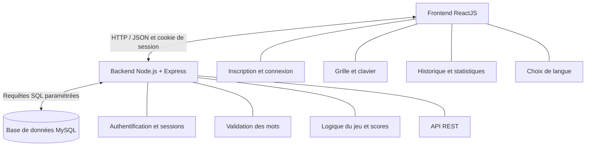
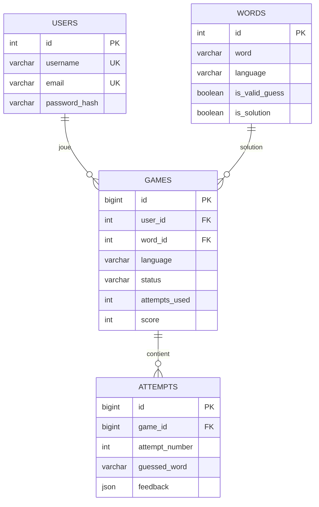

# Cahier des charges — Développement d'un jeu Wordle

**Version :** 1.0
**Date :** 19 octobre 2026
**Technologies :** ReactJS, Node.js, Express.js et MySQL

## 1. Présentation du projet

### 1.1 Contexte

Le projet consiste à développer une application web inspirée du jeu Wordle. Le joueur doit deviner un mot secret en six tentatives maximum. Après chaque proposition, le jeu affiche des indices visuels indiquant si les lettres sont absentes, présentes mais mal placées, ou correctement placées.

L'application intégrera un système d'inscription et de connexion permettant aux utilisateurs de jouer, d'enregistrer leurs scores et de consulter leur historique et leurs statistiques.

### 1.2 Objectifs

- Développer une interface interactive avec ReactJS.
- Permettre aux utilisateurs de créer un compte et de se connecter.
- Proposer des parties illimitées.
- Prendre en charge les langues française et anglaise.
- Implémenter les règles de Wordle, y compris la gestion des lettres répétées.
- Enregistrer les parties et les scores dans MySQL.
- Permettre la consultation de l'historique et des statistiques personnelles.
- Protéger les comptes et les données des utilisateurs.

### 1.3 Décisions retenues

| Élément | Décision |
|---|---|
| Langues | Français et anglais |
| Mode de jeu | Parties illimitées |
| Mot secret | Nouveau mot à chaque partie |
| Tentatives | 6 maximum |
| Score | Selon le nombre de tentatives |
| Authentification | Sessions serveur et cookies sécurisés |
| Historique | Disponible pour chaque utilisateur connecté |
| Statistiques | Statistiques personnelles |

## 2. Périmètre fonctionnel

| Fonctionnalité | Description | Priorité |
|---|---|---|
| Inscription | Création d'un compte | Indispensable |
| Connexion | Authentification sécurisée | Indispensable |
| Déconnexion | Fermeture de la session | Indispensable |
| Choix de langue | Français ou anglais | Indispensable |
| Dictionnaires | Validation des mots selon la langue | Indispensable |
| Parties illimitées | Nouvelle partie après une partie terminée | Indispensable |
| Grille de jeu | Six lignes de cinq lettres | Indispensable |
| Indices colorés | Retour visuel après chaque tentative | Indispensable |
| Sauvegarde des scores | Enregistrement dans MySQL | Indispensable |
| Historique | Consultation des parties précédentes | Indispensable |
| Statistiques | Victoires, défaites et scores | Important |
| Profil utilisateur | Consultation des informations | Important |
| Réinitialisation du mot de passe | Récupération du compte | Évolution possible |

## 3. Description des fonctionnalités

### 3.1 Inscription

Le formulaire d'inscription comprend :

- Un pseudonyme.
- Une adresse e-mail.
- Un mot de passe.

Le système devra vérifier les champs obligatoires, la validité de l'adresse e-mail, la robustesse du mot de passe et l'unicité du pseudonyme et de l'adresse e-mail.

Les mots de passe seront stockés sous forme de hash sécurisé, jamais en clair.

### 3.2 Connexion et déconnexion

L'utilisateur pourra se connecter avec son adresse e-mail ou son pseudonyme et son mot de passe.

Le système devra :

- Vérifier les identifiants.
- Créer une session côté serveur.
- Envoyer un cookie de session sécurisé au navigateur.
- Protéger les routes privées.
- Détruire la session lors de la déconnexion.
- Refuser l'accès aux données privées sans authentification.

### 3.3 Langues du jeu

L'utilisateur pourra choisir le français ou l'anglais avant de commencer une partie.

- Le mot secret contiendra cinq lettres.
- Le mot devra appartenir au dictionnaire de la langue choisie.
- Le backend assurera la validation des propositions.
- La gestion des accents français sera définie et appliquée de manière cohérente.
- Les mots anglais contenant des caractères spéciaux seront exclus de la V1.
- La langue sera enregistrée avec chaque partie.

Les dictionnaires devront être adaptés au jeu et leur source ainsi que leur licence devront être documentées.

### 3.4 Interface du jeu

L'écran principal comprendra :

- Un titre et un accès au profil.
- Un sélecteur de langue.
- Une grille de six lignes et cinq colonnes.
- Un clavier virtuel.
- Un bouton de validation.
- Une commande de suppression de la dernière lettre.
- Un message de victoire ou de défaite.
- Un bouton pour démarrer une nouvelle partie.
- Un accès à l'historique et aux statistiques.

L'interface sera responsive et utilisable au clavier.

### 3.5 Règles du jeu

1. Le joueur choisit la langue.
2. Le serveur sélectionne un mot secret de cinq lettres.
3. Le joueur dispose de six tentatives.
4. Chaque proposition doit être un mot valide de cinq lettres.
5. Après chaque tentative, les lettres reçoivent un indice :
   - **Vert :** lettre correcte et bien placée.
   - **Jaune :** lettre présente dans le mot secret, mais mal placée.
   - **Gris :** lettre absente, en tenant compte du nombre d'occurrences restantes.
6. La partie est gagnée lorsque le mot est trouvé.
7. La partie est perdue après six tentatives infructueuses.
8. Une partie terminée ne peut plus recevoir de tentative.

Le traitement des lettres répétées devra respecter le nombre réel d'occurrences dans le mot secret.

Le mot secret restera côté serveur et ne sera pas envoyé au frontend avant la fin de la partie.

### 3.6 Parties illimitées

L'utilisateur pourra démarrer une nouvelle partie après chaque victoire ou défaite.

Chaque nouvelle partie devra :

- Posséder un identifiant unique.
- Utiliser un nouveau mot sélectionné par le serveur.
- Réinitialiser le compteur de tentatives.
- Calculer son score indépendamment des parties précédentes.
- Être enregistrée dans l'historique.

La V1 ne comportera ni défi quotidien commun ni classement global.

### 3.7 Système de score

Le score sera calculé par le backend à la fin de la partie.

| Résultat | Score |
|---|---:|
| Victoire en 1 tentative | 1000 |
| Victoire en 2 tentatives | 800 |
| Victoire en 3 tentatives | 600 |
| Victoire en 4 tentatives | 400 |
| Victoire en 5 tentatives | 200 |
| Victoire en 6 tentatives | 100 |
| Défaite | 0 |

Le frontend ne pourra pas imposer le score final. Le backend le calculera à partir du résultat réel de la partie.

### 3.8 Historique et statistiques

Chaque utilisateur connecté pourra consulter uniquement ses propres résultats.

L'historique affichera :

- La date de la partie.
- La langue utilisée.
- Le résultat.
- Le nombre de tentatives.
- Le score obtenu.

Les statistiques comprendront :

- Le nombre total de parties terminées.
- Le nombre de victoires et de défaites.
- Le taux de réussite.
- Le score cumulé.
- Le nombre moyen de tentatives lors des victoires.
- La meilleure série de victoires consécutives.

## 4. Architecture technique

L'application reposera sur trois couches :



### 4.1 Technologies

| Couche | Technologie | Utilisation |
|---|---|---|
| Frontend | ReactJS | Interface utilisateur |
| Routage | React Router | Navigation |
| Appels API | Fetch ou Axios | Requêtes HTTP |
| Backend | Node.js | Logique serveur |
| Framework | Express.js | API REST |
| Base de données | MySQL | Stockage persistant |
| Accès aux données | mysql2 ou ORM | Communication SQL |
| Sessions | express-session | Gestion des sessions |
| Stockage des sessions | MySQL ou Redis | Persistance des sessions |
| Hash des mots de passe | Argon2id ou bcrypt | Sécurité |
| Versionnement | Git | Gestion du code source |

Le stockage mémoire par défaut d'`express-session` ne devra pas être utilisé en production.

## 5. Conception de la base de données MySQL

La base de données sera nommée `wordle_db`.

### 5.1 Table `users`

| Champ | Type | Description |
|---|---|---|
| id | INT UNSIGNED, PK, AUTO_INCREMENT | Identifiant unique |
| username | VARCHAR(30), UNIQUE | Pseudonyme |
| email | VARCHAR(255), UNIQUE | Adresse e-mail |
| password_hash | VARCHAR(255) | Hash du mot de passe |
| created_at | DATETIME | Date de création |
| updated_at | DATETIME | Date de modification |

### 5.2 Table `words`

| Champ | Type | Description |
|---|---|---|
| id | INT UNSIGNED, PK, AUTO_INCREMENT | Identifiant du mot |
| word | VARCHAR(20) | Mot normalisé |
| language | ENUM('fr','en') | Langue |
| is_valid_guess | BOOLEAN | Autorisé comme proposition |
| is_solution | BOOLEAN | Peut être sélectionné comme solution |
| is_active | BOOLEAN | Mot actif |

Une contrainte unique sur `(language, word)` évitera les doublons au sein d'une même langue.

### 5.3 Table `games`

| Champ | Type | Description |
|---|---|---|
| id | BIGINT UNSIGNED, PK, AUTO_INCREMENT | Identifiant de la partie |
| user_id | INT UNSIGNED, FK | Utilisateur propriétaire |
| word_id | INT UNSIGNED, FK | Mot secret |
| language | ENUM('fr','en') | Langue de la partie |
| status | ENUM('in_progress','won','lost') | État de la partie |
| attempts_used | TINYINT UNSIGNED | Tentatives utilisées |
| score | INT UNSIGNED | Score final |
| started_at | DATETIME | Début de la partie |
| finished_at | DATETIME, nullable | Fin de la partie |

Index recommandés :

- `(user_id, started_at)`
- `(user_id, status)`

### 5.4 Table `attempts`

| Champ | Type | Description |
|---|---|---|
| id | BIGINT UNSIGNED, PK, AUTO_INCREMENT | Identifiant de la tentative |
| game_id | BIGINT UNSIGNED, FK | Partie concernée |
| attempt_number | TINYINT UNSIGNED | Numéro de la tentative |
| guessed_word | VARCHAR(20) | Proposition normalisée |
| feedback | JSON | Résultat de chaque lettre |
| created_at | DATETIME | Date de la tentative |

Une contrainte unique sur `(game_id, attempt_number)` empêchera les doublons. Le backend garantira que le numéro est compris entre 1 et 6.

### 5.5 Stockage des sessions

Les sessions seront gérées par `express-session` et un magasin de sessions compatible avec la production, par exemple MySQL ou Redis.

Les sessions seront séparées des données métier. Les sessions expirées devront être supprimées régulièrement.

### 5.6 Relations entre les tables



## 6. API REST du backend

Toutes les routes privées nécessiteront une session authentifiée. Les échanges se feront au format JSON.

### 6.1 Authentification

| Méthode | Endpoint | Description |
|---|---|---|
| POST | `/api/auth/register` | Créer un compte |
| POST | `/api/auth/login` | Se connecter |
| POST | `/api/auth/logout` | Détruire la session |
| GET | `/api/auth/me` | Obtenir l'utilisateur connecté |

### 6.2 Parties

| Méthode | Endpoint | Description |
|---|---|---|
| POST | `/api/games` | Créer une nouvelle partie |
| GET | `/api/games/:id` | Consulter une partie autorisée |
| POST | `/api/games/:id/attempts` | Soumettre une proposition |
| GET | `/api/games/history` | Consulter l'historique |
| GET | `/api/games/stats` | Obtenir les statistiques |

### 6.3 Création d'une partiem

Requête :

```json
{
  "language": "fr"
}
```

La langue doit être `fr` ou `en`. Le serveur sélectionne un mot secret adapté, crée la partie et renvoie son identifiant, son état et le nombre de tentatives restantes.

Le mot secret ne doit pas être inclus dans la réponse.

### 6.4 Soumission d'une tentative

Requête :

```json
{
  "word": "POMME"
}
```

Exemple de réponse :

```json
{
  "attemptNumber": 2,
  "feedback": [
    "correct",
    "absent",
    "present",
    "absent",
    "correct"
  ],
  "status": "in_progress",
  "attemptsRemaining": 4
}
```

Cet exemple est illustratif.

Le serveur doit vérifier que :

- La partie existe et appartient à l'utilisateur connecté.
- La partie est toujours en cours.
- Le nombre de tentatives maximal n'est pas dépassé.
- La proposition respecte les règles de la langue.
- Le mot appartient au dictionnaire autorisé.
- La tentative est enregistrée de manière cohérente.

À la fin de la partie, le serveur met à jour le statut, calcule le score et enregistre l'heure de fin.

### 6.5 Codes d'erreur

| Code HTTP | Utilisation |
|---|---|
| 400 | Données invalides |
| 401 | Utilisateur non authentifié |
| 403 | Action interdite |
| 404 | Ressource inexistante ou non accessible |
| 409 | Conflit, par exemple compte déjà existant |
| 429 | Trop de requêtes |
| 500 | Erreur serveur inattendue |

Les erreurs ne devront jamais divulguer le mot secret ou des données appartenant à un autre utilisateur.

## 7. Sécurité

### 7.1 Mots de passe

- Utiliser Argon2id ou bcrypt.
- Ne jamais stocker les mots de passe en clair.
- Ne jamais transmettre le hash au frontend.
- Appliquer une politique de robustesse raisonnable.

### 7.2 Sessions et cookies

L'authentification reposera sur des sessions conservées côté serveur.

Le cookie de session devra :

- Utiliser `HttpOnly`.
- Utiliser `Secure` en production sous HTTPS.
- Avoir un attribut `SameSite` adapté au déploiement.
- Avoir une durée de vie limitée.
- Être renouvelé après l'authentification.
- Être invalidé lors de la déconnexion.

Le secret de session sera stocké dans une variable d'environnement. Une protection CSRF adaptée devra être mise en place pour les opérations qui modifient des données.

### 7.3 Protection des données

- Utiliser des requêtes SQL paramétrées.
- Valider toutes les données côté serveur.
- Vérifier les droits d'accès à chaque partie.
- Limiter les tentatives de connexion.
- Utiliser HTTPS en production.
- Stocker les secrets dans des variables d'environnement.
- Ne pas exposer le mot secret avant la fin de la partie.
- Calculer les scores côté serveur.
- Ne pas inclure de données sensibles dans les journaux.
- Mettre en place des sauvegardes régulières.

### 7.4 Intégrité des parties

Les tentatives, le statut et le score seront contrôlés côté serveur. Une partie terminée ne pourra pas recevoir de nouvelles tentatives. Les écritures liées à une tentative et à la fin d'une partie devront être cohérentes, idéalement à l'aide de transactions SQL.

## 8. Exigences non fonctionnelles

### 8.1 Performance

- Chargement rapide des pages dans des conditions normales.
- Requêtes SQL optimisées et indexées.
- Prise en charge de plusieurs utilisateurs simultanés.
- Prévention des écritures incohérentes en cas de requêtes concurrentes.

### 8.2 Ergonomie et accessibilité

- Interface responsive.
- Navigation au clavier.
- Messages d'erreur compréhensibles.
- Contraste suffisant.
- Indices non fondés uniquement sur la couleur.

### 8.3 Maintenabilité

- Composants React réutilisables.
- Séparation des routes, contrôleurs, services et accès aux données.
- Versionnement avec Git.
- Fichier `.env.example` sans secrets.
- Documentation de l'installation et de l'API.

### 8.4 Compatibilité

L'application devra fonctionner sur les versions récentes de Chrome, Firefox, Edge et Safari.

## 9. Tests et critères d'acceptation

| Catégorie | Tests |
|---|---|
| Inscription | Compte valide, e-mail ou pseudonyme en doublon |
| Connexion | Identifiants corrects et incorrects |
| Déconnexion | Session invalidée |
| Sessions | Cookie sécurisé, expiration, protection CSRF |
| Langues | Dictionnaires français et anglais |
| Règles du jeu | Lettres correctes, présentes, absentes et répétées |
| Limites | Six tentatives maximum |
| Parties illimitées | Nouvelle partie après victoire ou défaite |
| Score | Barème respecté pour chaque résultat |
| Persistance | Historique conservé après reconnexion |
| Autorisations | Impossible d'accéder aux parties d'un autre utilisateur |
| Sécurité | Injections SQL et entrées invalides |
| Responsive | Affichage sur ordinateur et mobile |
| Statistiques | Résultats cohérents avec les données enregistrées |

### Critères d'acceptation fonctionnels

Le projet sera accepté lorsque :

1. Un utilisateur peut créer un compte, se connecter et se déconnecter.
2. L'authentification repose sur une session serveur et un cookie sécurisé.
3. L'utilisateur peut choisir le français ou l'anglais.
4. Le serveur sélectionne un mot adapté à la langue.
5. Chaque partie autorise six tentatives maximum.
6. Les indices sont corrects, y compris pour les lettres répétées.
7. Une partie terminée ne peut plus être modifiée.
8. L'utilisateur peut jouer un nombre illimité de parties.
9. Le score est calculé par le serveur selon le barème défini.
10. Les parties et scores sont enregistrés dans MySQL.
11. L'utilisateur peut consulter son historique et ses statistiques.
12. Les données privées sont isolées par utilisateur.
13. Le mot secret n'est pas transmis avant la fin.
14. Aucun classement global n'est nécessaire en V1.
15. L'application est utilisable sur ordinateur et smartphone.

## 10. Organisation du développement

### Étape 1 — Conception

- Finaliser les règles et le barème.
- Préparer les maquettes.
- Concevoir le schéma MySQL.
- Définir les contrats de l'API.

### Étape 2 — Backend et base de données

- Créer les tables et les relations.
- Importer les dictionnaires français et anglais.
- Développer l'inscription, la connexion et les sessions.
- Développer la logique des parties et le calcul des scores.
- Créer les endpoints de l'API.

### Étape 3 — Frontend

- Créer les pages d'inscription et de connexion.
- Développer la grille et le clavier.
- Ajouter le choix de langue.
- Connecter le frontend à l'API.
- Développer l'historique et les statistiques.

### Étape 4 — Intégration et tests

- Tester les règles du jeu.
- Vérifier la persistance des données.
- Tester les droits d'accès et les sessions.
- Tester les différentes tailles d'écran.
- Corriger les anomalies.

### Étape 5 — Livraison

- Documenter l'installation et la configuration.
- Préparer les variables d'environnement.
- Fournir les scripts SQL et les dictionnaires.
- Documenter le déploiement si nécessaire.

Une estimation indicative de trois à cinq semaines peut être envisagée selon l'expérience du développeur, la disponibilité des dictionnaires et le niveau de finition attendu.

## 11. Livrables attendus

- Code source ReactJS du frontend.
- Code source Node.js/Express du backend.
- Script SQL de création des tables et des index.
- Dictionnaires français et anglais, avec leurs sources et licences.
- Fichier `.env.example` sans informations secrètes.
- Documentation des endpoints REST.
- Instructions d'installation et de lancement en local.
- Documentation des tests.
- Procédure de déploiement, si nécessaire.

## 12. Fonctionnalités exclues de la V1

Les éléments suivants sont exclus de la première version :

- Classement global entre joueurs.
- Défi quotidien commun.
- Mode multijoueur en direct.
- Application mobile native.
- Connexion via des comptes tiers.

Ils pourront être étudiés dans une version ultérieure.

## 13. Conclusion

La première version de Wordle sera une application web utilisant ReactJS, Node.js/Express et MySQL. Elle proposera une authentification par sessions sécurisées, des parties illimitées en français et en anglais, un score calculé selon le nombre de tentatives, ainsi qu'un historique et des statistiques personnels.

La logique du jeu, la validation des mots, la sélection de la solution et le calcul du score seront contrôlés par le backend. MySQL assurera la persistance des comptes, des parties et des tentatives. Le classement global et le défi quotidien sont exclus de la première version.
